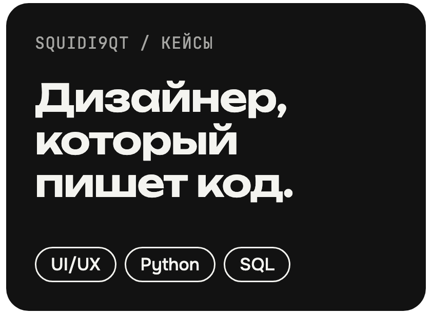
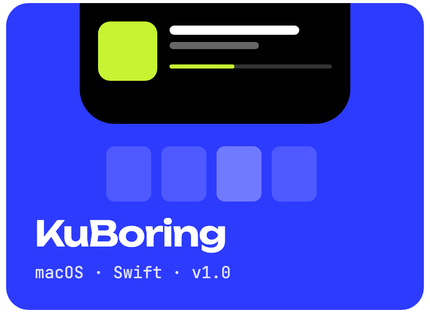
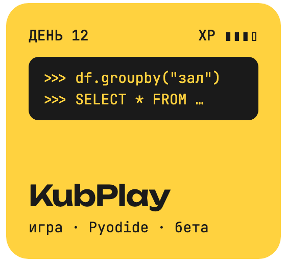
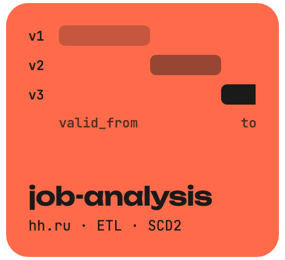
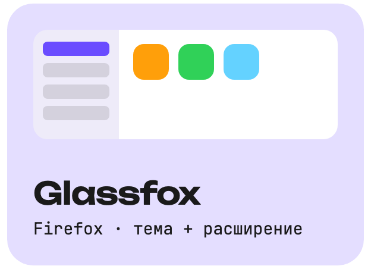
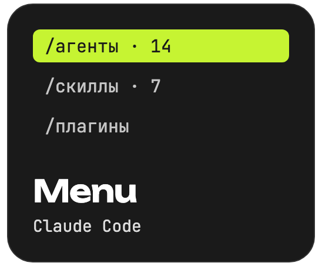
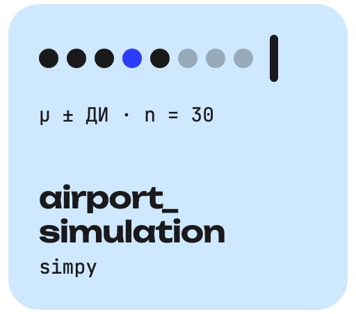
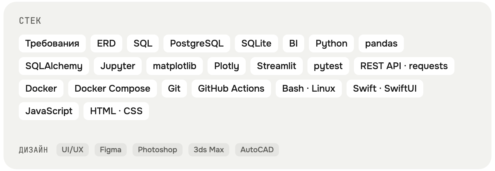

<a href="https://github.com/Squidi9QT"><picture><source media="(prefers-color-scheme: dark)" srcset="assets/hero-dark.png"></picture></a>   <a href="https://github.com/Squidi9QT"><picture><source media="(prefers-color-scheme: dark)" srcset="assets/stack-dark.png"></picture></a> <a href="mailto:kub.idrissov@gmail.com"><picture><source media="(prefers-color-scheme: dark)" srcset="assets/email-dark.png"></picture></a><a href="https://github.com/Squidi9QT"><picture><source media="(prefers-color-scheme: dark)" srcset="assets/place-dark.png"></picture></a> <a href="https://github.com/Squidi9QT"><picture><source media="(prefers-color-scheme: dark)" srcset="assets/signature-dark.png"></picture></a>

## Кейсы

<b>KuBoring</b>: шторка у выреза экрана для macOS

**Задача.** Хотел держать музыку, файлы и буфер обмена в одном месте, прямо у выреза экрана.

**Решение.** Нативное приложение на Swift и SwiftUI. Музыка из любого плеера с текстом песен, полка для файлов, история буфера по ⌘⇧V, таймер, ИИ-сервисы, календарь с кнопкой «Войти» на созвон. Каждая функция живёт в своём модуле и включается в настройках.

**Итог.** Вышел релиз v1.0, его можно скачать и поставить. [Репозиторий →](https://github.com/Squidi9QT/KuBoring)

<b>KubPlay</b>: игра, которая учит Python, pandas и SQL

**Задача.** Учить Python, pandas и SQL на задаче, похожей на работу аналитика, а не по задачникам.

**Решение.** Браузерная игра: автоматизируешь ежедневный отчёт, пишешь код и SQL-запросы, и они выполняются прямо на странице через Pyodide и SQLite, без сервера. Две кампании, конвейер из пяти станций, бесконечные дни, тёмная тема. Делал вместе с Claude.

**Итог.** Рабочая бета, после первого запуска работает без интернета. [Репозиторий →](https://github.com/Squidi9QT/KubPlay)

<b>BrandHub</b>: куда перенести рекламу в детском парке ТРЦ

**Задача.** Понять, в каких зонах парка бывает нужная бренду аудитория и какие размещения стоят не там.

**Решение.** Модель данных в PostgreSQL из 8 таблиц, 5 SQL-запросов с CTE и оконными функциями, от топа зон до рекомендаций, и дашборд на Streamlit и Plotly. Запускается одной командой.

**Итог.** Дашборд показывает, какие размещения выгоднее перенести и на сколько вырастет совпадение аудитории. Это пересборка с нуля проекта, который я делал по работе, данные синтетические. [Репозиторий →](https://github.com/Squidi9QT/BrandHub)

<b>job-analysis</b>: вакансии hh.ru с историей SCD2

**Задача.** Собирать вакансии с hh.ru и хранить, как каждая менялась со временем.

**Решение.** ETL на Python, хранение в PostgreSQL с историей изменений по SCD2, SQL-аналитика и интерактивное демо.

**Итог.** Демо открывается на [GitHub Pages](https://squidi9qt.github.io/job-analysis/). [Репозиторий →](https://github.com/Squidi9QT/job-analysis)

<b>Glassfox</b>: Firefox в стиле Apple

**Задача.** Firefox хотелось сделать аккуратнее, в духе программ Apple.

**Решение.** Тема с вкладками-капсулами, мягкими тенями и анимациями. К ней расширение: все вкладки и любимые сайты по одному клику и радио со спокойной музыкой в боковой панели.

**Итог.** Расширение подписано в Mozilla и ставится насовсем. [Репозиторий →](https://github.com/Squidi9QT/Glassfox)

<b>Menu</b>: Claude Code в одно нажатие

**Задача.** Когда скиллов и агентов в Claude Code много, команды трудно держать в голове.

**Решение.** Боковое меню прямо в Claude Code: агенты, скиллы и плагины видны списком, нажатие вставляет команду в сообщение. Внутри набор из 7 скиллов и 14 субагентов, ставится одной командой.

**Итог.** Выложил, чтобы другие могли поставить себе. [Репозиторий →](https://github.com/Squidi9QT/Menu)

<b>airport_simulation</b>: очередь в аэропорту на simpy

**Задача.** Посчитать, сколько пассажиры ждут у стоек регистрации.

**Решение.** Модель очереди M/G/N на simpy: 3 стойки, 30 независимых прогонов, 95% доверительный интервал.

**Итог.** Среднее ожидание около 2,97 ± 0,53 минуты. [Репозиторий →](https://github.com/Squidi9QT/airport_simulation)

